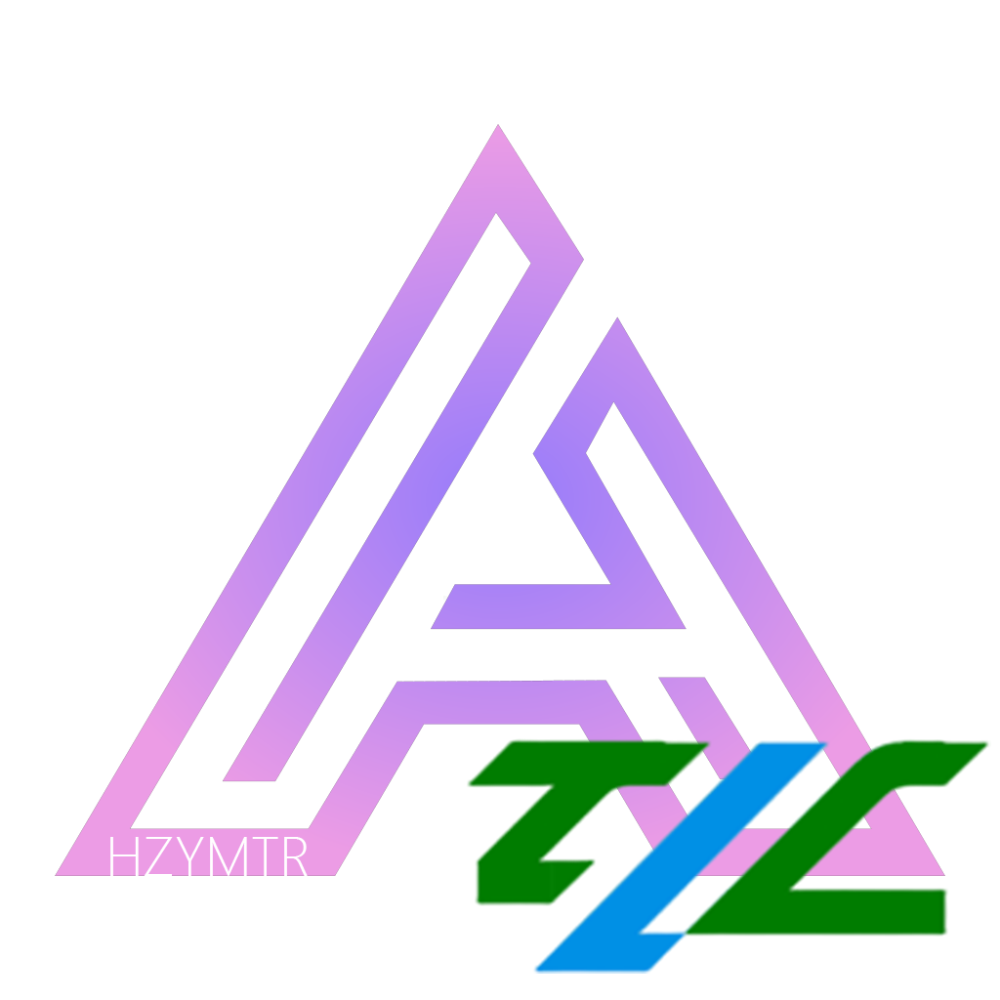

# hANTE

<p align="left">
  
</p>

<p align="left"><a href="#english">English</a> | 中文</p>

基于 [Aphrodite's Nemo's Transit Expansion (MTR-ANTE)](https://github.com/aphrodite281/mtr-ante)
的独立分支，针对 **YMTR**（Minecraft Transit Railway 的第三方分支）做了兼容与手感调整，
并移植了上游的部分修复。

本仓库**不是**准备合并回上游的 PR 分支，而是一条独立维护的线路 —— 与上游的功能取向
已经分化（上游侧重 JS 引擎与新功能，本分支侧重 YMTR 兼容与手感/性能），故单独建库。
上游历史完整保留，便于随时挑选需要的修复。

---

## 与上游的差异

### 飞机跨机场路径修复（本分支）

ANTE 原版（以及 hANTE 1.1.2 早期构建）在跨机场生成路径时会报
`gui.mtr.path_not_found_between`（“在 A 与 B 之间找不到路径”）。原因是
`BetterPathFinder.addPathPart` 缺少 MTR/YMTR 原版 `PathFinder` 中的“跑道起飞”分支：
当列车位于 `RailType.RUNWAY`、且该点只有一个连接时，原版会把所有跑道端点加入候选，
ANTE 改写后没有这一步，导致飞机无法从跑道端点进入空中段。

本分支恢复了该分支，并补上：

- `PathPart` 的 `airborne` 状态，避免在空中段重复触发跑道逻辑；
- 跳过当前跑道端点与已访问位置，防止自环；
- `addAirplanePath` 按 8 方向计算转向步数（不再依赖 `RailAngle` 枚举身份比较）；
- 对 `lastConnections`、`newConnections`、`calculateNewDirection` 的空值保护。

修复后主路径可以正常生成。若整条车厂路径仍失败，通常是**地图拓扑**问题，例如：

- 单向跑道只支持一个方向（回程没有起飞/降落跑道）；
- 车厂范围内存在完全孤立的侧线，导致车厂取所有侧线的最小成功段数。

### 增强型手动驾驶（移植自 NeoMTR 内置 NTE）

本分支把 [NeoMTR](https://github.com/zbx1425/NeoMTR) 内置 NTE 的
**增强型手动驾驶**移植到了 hANTE，适配 Minecraft 1.20.1 / Forge / YMTR 3.6.3。

#### 功能

- `/mtrnte virtdrive`：接管当前乘坐的自动运行列车；
- 原版 `drive_hmi.png` 仪表：圆形速度表、ATP 黄/红针、目标速度、目标距离条；
- 牵引/制动级位、车门联锁、停站对标信息、超速 ATP 紧急制动；
- 虚拟列车会隐藏原车，避免两辆车头重叠；
- 退出时清理 MTR 传送/座位状态，避免浮空、无法跳跃/潜行或 `/kill` 无效；
- 服务端与客户端使用同一 jar 时支持多人。

#### 教程

1. **客户端和服务端都安装同一个 hANTE jar**，重启；
2. 右键坐进一辆**自动运行**的列车；
3. 输入：
   ```
   /mtrnte virtdrive
   ```
4. 驾驶键位（MTR 3.6.3 默认）：
   - `↑` / `W`：加速
   - `↓` / `S`：制动
   - `←`：开关车门
   - `X`：回零/惰行
   - 按住潜行约 1.5 秒：退出虚拟驾驶
5. 其他指令：
   - `/mtrnte virtdrive atpcutout`：切除/恢复 ATP（默认开启）；
   - `/mtrnte virtdrive reset`：退出后若卡在浮空/传送状态，用它强制清理。
6. 停站接管时给牵引会自动关门，等门动画结束即可起步。

ATP 默认开启；超过 ATP 红针会触发紧急制动。需要完全手动控制时可先执行
`atpcutout`。

### 相机与视角

- **相机惯性**：新增 `CameraInertia` + `CameraAccessor`，把惯性偏移烘焙进相机位置
- **视角滚转**：`Rolling` 重写，支持相机与乘坐位置跟随列车滚转，可单独关闭相机滚转
- **车厢稳定**：`VehicleRidingClientMixin` 重构，车厢改用**不含惯性偏移**的相机位置
  —— 解决「相机在车厢里晃、车厢在画面上跟着被推走」的问题
- **滚转不再压低相机**（1.1.2）：`Rolling.applyRolling` 把滚转造成的相机 Y 位移拉回原值，
  只保留水平面内的位移 —— 过超高弯时不再有「相机被压向地面」的观感；朝向倾斜完全不受影响
- **惯性不再被误清**（1.1.2）：「滚转归零」与「判定下车」拆成两个超时。
  原先 `setOffsets` 在停站 / 低速 / 进出站时中断 1 秒就会被判成下车，`CameraInertia`
  随即 `reset()` 把前 / 侧 / 上三个偏移全部清零 —— 侧向晃动因此永远建立不起来
- **过弯改成离心力手感**（1.1.2）：侧向单独钉在**临界阻尼**（无超调、单调到位、不回弹），
  不再一进弯就来回摆；侧向增益 8 → **26**（实测侧向偏移原先只有 0.01~0.12 格，
  而纵向有 0.18 格，差十几倍）

### YMTR 兼容

- `YmtrAnteFallbackMixin`：关闭 YMTR 的 ANTE fallback 轨道渲染路径。
  该路径每帧对每根铁轨调用两次 `Rail.getPosition`，实测会把帧率压到原来的 1/5。
  机制说明见该文件头部注释。

### Bug 修复（移植自上游 1.1.1）

| 问题 | 修复 |
| --- | --- |
| 飞机跨机场无法创建路径 | 恢复 `addPathPart` 的跑道起飞分支，详见上文“飞机跨机场路径修复” |
| 缆车在某些角度无法连接 | `RailCalculator.calculate` 不再用 `Section.isValid()` 过滤结果 —— 该检查只判断各参数是否有限，出现 NaN 就把整组作废 |

---

## 版本

当前 **1.1.3**，基线为上游 `alpha` 分支的 `0506691f`。

### 1.1.3 主要变更

- 修复飞机跨机场路径找不到 runway 起飞段的问题；
- 移植 NeoMTR 内置 NTE 的增强型手动驾驶（HMI、ATP、虚拟列车、指令与教程见上文）；
- 修复虚拟驾驶退出后的浮空、无法跳跃/潜行、`/kill` 无效和偶尔被传送到列车上的问题；
- 修复停站接管时车门联锁导致无法起步、基础模拟把速度夹在 20 km/h 的问题；
- 模组名称、作者、主页、许可证与图标更新为 HZYMTR 分支信息。

---

## 构建

环境要求 **JDK 17**。注意不是 21，原因见下。

```powershell
$env:JAVA_HOME = "<你的 JDK 17 路径>"
$env:GRADLE_USER_HOME = "<你的 Gradle 缓存路径>"
.\gradlew.bat build
```

产物：`forge/build/libs/forge-<版本>+1.20.1.jar`

两个已知的构建陷阱：

1. **不要加 `--offline`** —— 首次构建需要联网拉取 parchment 映射，离线会直接解析失败。
2. **必须用 JDK 17 编译**。用 JDK 19 及以上会触发 loom 的 LWJGL 升级流程去修改依赖仓库，
   在 Gradle 8.11 + Architectury Loom 1.9.424 下报
   `Cannot mutate content repository descriptor 'LoomLocalRemappedMods(...)' after repository has been used`
   导致配置阶段失败。换回 JDK 17 即可绕过。
3. 若 `:forge:remapJar` 报 `Jar ... already contains an access transformer`，
   是增量缓存不一致，执行一次 `gradlew clean build`。

---

## 与上游同步

```powershell
git fetch upstream
git log upstream/alpha --oneline -10      # 看上游有什么新东西
git cherry-pick <需要的提交>
```

---

## 授权与致谢

授权继承上游，详见 [LICENSE](LICENSE)。

原项目 MTR-ANTE（原名 MTRSteamLoco）由 **Zbx1425** 创建于
[Teacon 2022](https://teacon.cn) 模组开发活动，现由 **Aphrodite** 开发维护。

- 上游仓库：https://github.com/aphrodite281/mtr-ante
- 上游文档：https://aphrodite281.github.io/mtr-ante/#
- 上游 Modrinth：https://modrinth.com/mod/mtr-ante
- 依赖的 MTR 本体：https://github.com/jonafanho/Minecraft-Transit-Railway

---

# English

hANTE is an independent fork of
[Aphrodite's Nemo's Transit Expansion (MTR-ANTE)](https://github.com/aphrodite281/mtr-ante),
targeting **Minecraft 1.20.1 / Forge** and **MTR 3** (including YMTR).
It focuses on compatibility, driving/camera feel, performance, and selected upstream fixes.

This repository is **not** a pull-request branch intended to be merged upstream; it is a
separately maintained line. The full upstream history is preserved so useful fixes can be
cherry-picked at any time.

## Differences from upstream

### Cross-airport airplane path fix

ANTE (and early hANTE 1.1.2 builds) can report
`gui.mtr.path_not_found_between` when generating a path between two airports. The cause is
that `BetterPathFinder.addPathPart` was missing the runway-takeoff branch used by the
original MTR/YMTR `PathFinder`: when a train is on a `RailType.RUNWAY` position with exactly
one connection, the original adds all runway endpoints as jump targets. ANTE's rewrite did
not, so an airplane could not leave the runway endpoint and enter the airborne segment.

hANTE restores that branch and adds:

- an `airborne` flag on `PathPart` so runway logic is not re-triggered in the air;
- skipping the current runway endpoint and already visited positions to prevent self-loops;
- 8-direction turn-step calculation in `addAirplanePath` (no `RailAngle` enum identity
  comparison);
- null guards for `lastConnections`, `newConnections`, and `calculateNewDirection`.

The main route can now be generated correctly. If a depot still fails as a whole, it is
usually a **map topology** issue, for example:

- a one-way runway supports only one direction (no takeoff/landing runway for the return leg);
- a completely isolated siding inside the depot area makes the depot take the minimum
  successful segment count across all sidings.

### Enhanced manual driving (ported from NeoMTR's built-in NTE)

hANTE ports the **enhanced manual driving** feature from
[NeoMTR](https://github.com/zbx1425/NeoMTR)'s built-in NTE to Minecraft 1.20.1 / Forge /
YMTR 3.6.3.

Features:

- `/mtrnte virtdrive` takes over the train you are currently riding;
- the original `drive_hmi.png` cab display: round speedometer, ATP yellow/red needles,
  target speed and target-distance bar;
- traction/brake notches, door interlock, platform-door alignment information, and ATP
  overspeed emergency braking;
- the virtual train hides the original one, avoiding two overlapping train fronts;
- on exit, MTR teleport/seat state is cleaned up to prevent floating, disabled jump/sneak,
  ineffective `/kill`, or being teleported back onto a train;
- multiplayer support when client and server use the same jar.

Tutorial:

1. Install the **same hANTE jar on both client and server**, then restart.
2. Right-click to sit in an **automatically running** train.
3. Run:
   ```
   /mtrnte virtdrive
   ```
4. Default controls (MTR 3.6.3):
   - `↑` / `W`: accelerate
   - `↓` / `S`: brake
   - `←`: toggle doors
   - `X`: neutral / coast
   - hold sneak for about 1.5 seconds: exit virtual driving
5. Other commands:
   - `/mtrnte virtdrive atpcutout`: cut out / restore ATP (ATP is enabled by default);
   - `/mtrnte virtdrive reset`: force-clear a stuck teleport/seat state after exiting.
6. When taking over at a station, applying power automatically closes the doors; wait for
   the door animation, then the train can move.

ATP is enabled by default; exceeding the ATP red needle triggers emergency braking. Use
`atpcutout` when full manual control is desired.

### Camera and view

- **Camera inertia**: `CameraInertia` + `CameraAccessor` bake the inertia offset into the
  camera position.
- **View roll**: `Rolling` supports camera and passenger-position roll with the train; camera
  roll can be disabled separately.
- **Car stability**: `VehicleRidingClientMixin` was reworked so cars use a camera position
  without the inertia offset — fixing the "camera shakes inside the car while the car is
  pushed around the screen" problem.
- **Roll no longer pushes the camera down** (1.1.2): `Rolling.applyRolling` restores the Y
  displacement caused by roll and keeps only the horizontal displacement.
- **Inertia is no longer reset incorrectly** (1.1.2): "roll zero" and "left the train" use
  separate timeouts.
- **Cornering uses a centrifugal feel** (1.1.2): lateral motion is critically damped with no
  overshoot; lateral gain was increased from 8 to 26.

### YMTR compatibility

- `YmtrAnteFallbackMixin` disables YMTR's ANTE fallback rail-rendering path. That path calls
  `Rail.getPosition` twice per rail per frame and was measured to reduce FPS to about 1/5.

### Bug fixes

| Problem | Fix |
| --- | --- |
| Cross-airport airplane path cannot be created | Restore the runway-takeoff branch in `addPathPart` (see above) |
| Cable car cannot connect at some angles | `RailCalculator.calculate` no longer filters results with `Section.isValid()` — a NaN in any parameter discarded the whole result |

## Version

Current version: **1.1.3**, based on upstream `alpha` at `0506691f`.

### 1.1.3 highlights

- Fixed the missing runway-takeoff segment for cross-airport airplane pathfinding;
- ported NeoMTR's built-in NTE enhanced manual driving (HMI, ATP, virtual train, commands and
  tutorial above);
- fixed floating / disabled jump and sneak / ineffective `/kill` / occasional teleport back
  onto a train after exiting virtual driving;
- fixed the station door interlock preventing departure and the base simulation clamping
  speed to 20 km/h;
- updated mod name, authors, homepage, MIT license, and icon for the HZYMTR branch.

## Compatibility

- Minecraft **1.20.1**
- Forge
- MTR **3** (tested with YMTR 3.6.3)
- Client and server must use the same jar for multiplayer virtual driving

## Building

Requires **JDK 17** (not 21).

```powershell
$env:JAVA_HOME = "<your JDK 17 path>"
$env:GRADLE_USER_HOME = "<your Gradle cache path>"
.\\gradlew.bat build
```

Output: `forge/build/libs/forge-<version>+1.20.1.jar`

Known build traps:

1. Do **not** use `--offline` — the first build needs network access for parchment mappings.
2. Use **JDK 17**. JDK 19+ triggers Loom's LWJGL upgrade flow and can fail with
   `Cannot mutate content repository descriptor 'LoomLocalRemappedMods(...)' after repository has been used`.
3. If `:forge:remapJar` reports
   `Jar ... already contains an access transformer`, run a clean build.

## License and credits

Licensed under the MIT license inherited from upstream; see [LICENSE](LICENSE).

MTR-ANTE (formerly MTRSteamLoco) was created by **Zbx1425** at
[Teacon 2022](https://teacon.cn) and is maintained by **Aphrodite**.
This fork is maintained by **HZYZHZY** and **Ch1hayaAnonQWQ**.

The enhanced manual driving implementation is ported from
[NeoMTR](https://github.com/zbx1425/NeoMTR)'s built-in NTE.

- Upstream repository: https://github.com/aphrodite281/mtr-ante
- Upstream documentation: https://aphrodite281.github.io/mtr-ante/#
- Upstream Modrinth: https://modrinth.com/mod/mtr-ante
- MTR: https://github.com/jonafanho/Minecraft-Transit-Railway
